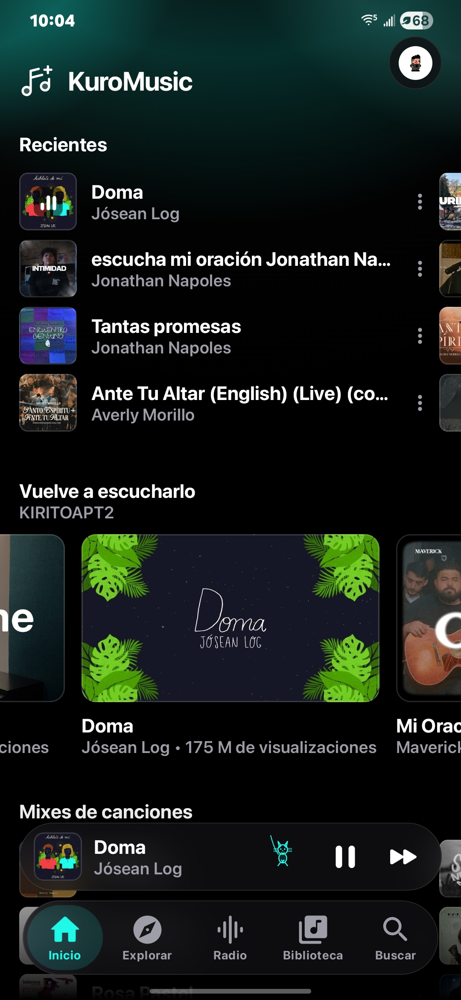
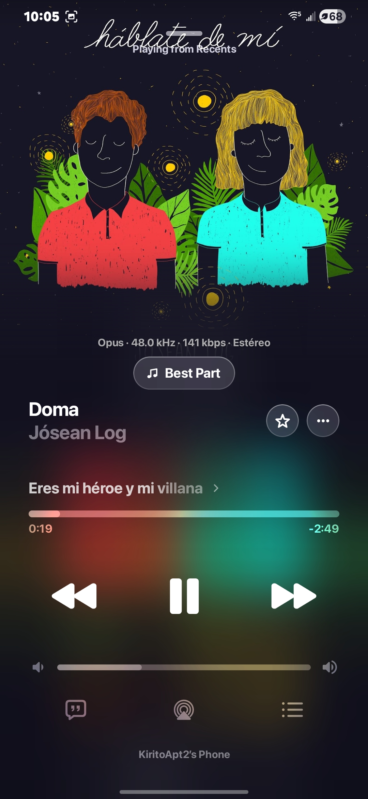
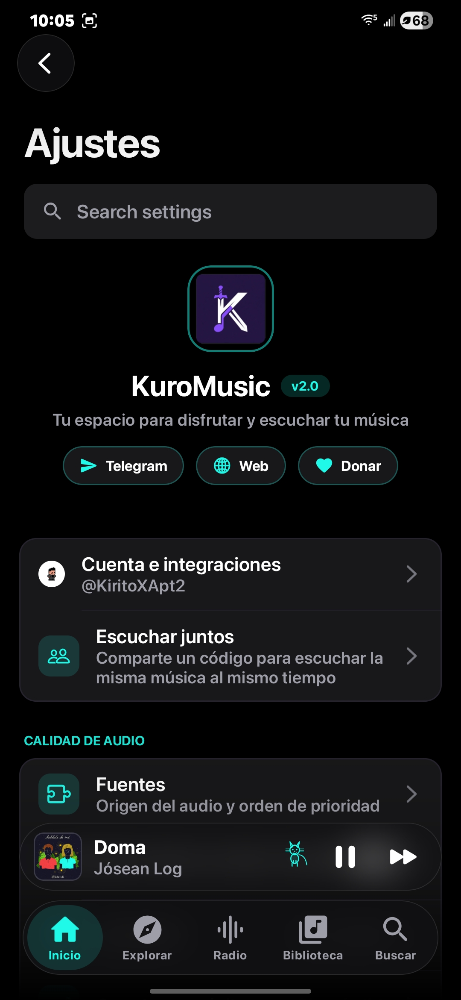

<div align="center">

```ocaml
KUROMUSIC 2.0 • CLIENTE DE MÚSICA PARA ANDROID
```

</div>

<h1 align="center">
  <br>
    <a href="https://github.com/KiritoAPT2/KuroMusic"></a>
      <br>
      KuroMusic
  <br>
</h1>

<p align="center">
  <a href="https://github.com/KiritoAPT2/KuroMusic/releases/latest"></a>
  <a href="https://github.com/KiritoAPT2/KuroMusic/releases"></a>
  <a href="https://github.com/KiritoAPT2/KuroMusic/blob/main/LICENSE"></a>
  <a href="https://t.me/KiritoAPT2"></a>
  <a href="https://kiritoapt2.github.io/KuroMusic-Web/"></a>
</p>

<pre align="center">
  <a href="#caracteristicas">CARACTERÍSTICAS</a> • <a href="#compilacion">COMPILACIÓN</a> • <a href="#dependencias">DEPENDENCIAS</a> • <a href="#descargar">DESCARGAR</a> • <a href="#agradecimientos">AGRADECIMIENTOS</a> • <a href="#licencia">LICENCIA</a>
</pre>

<p align="center">
  
</p>

<p align="center">
  <em>Cliente de música para Android con interfaz fluida, fondo Aurora dinámico y reproducción sin anuncios. Visita la web oficial en <a href="https://kiritoapt2.github.io/KuroMusic-Web/">kiritoapt2.github.io/KuroMusic-Web</a>.</em>
</p>

## :octocat: ‎ <sup><sub><samp>¡HOLA! ¡GRACIAS POR VENIR!</samp></sub></sup>


**KuroMusic 2.0** es un reproductor de música y cliente de YouTube Music para Android diseñado con enfoque en fluidez, estabilidad de sesión (con cuenta o como invitado), audio de alta calidad y personalización visual con **Aurora dinámica** según la carátula actual y **BeatBuddy** en el reproductor.

> [!IMPORTANT]
> KuroMusic no está afiliado, respaldado ni conectado con YouTube ni Google LLC. Úsalo bajo tu propio criterio.

## <samp><a id="capturas"></a>Capturas de pantalla</samp>

<p align="center">
  
  
  
</p>

## <samp><a id="caracteristicas"></a>Características</samp>

- **Aurora dinámica:** Fondo ambiental en Inicio que adapta su color vibrante a la carátula en reproducción.
- **BeatBuddy en MiniPlayer:** Mascota animada (gato u oso) bailando al ritmo de la música.
- **Selección rápida al instante:** Acceso directo en la parte superior del Inicio, Explorar, Radio, Biblioteca y Búsqueda.
- **Audio avanzado:** Audio Espacial, normalización de volumen, saltar silencio, crossfade y salida bit-perfect por USB DAC.
- **Letras y carátulas animadas:** Letras sincronizadas en tiempo real y portadas animadas (Canvas).
- **Sesión estable y modo invitado:** Renovación automática de sesión con cuenta Google y soporte completo sin cuenta.
- **Actualizador integrado:** Notifica, descarga e instala nuevas versiones directamente desde GitHub Releases.

## <samp><a id="compilacion"></a>Compilación</samp>

Requiere JDK 17, Android SDK y NDK 27.

```bash
git clone https://github.com/KiritoAPT2/KuroMusic.git
cd KuroMusic
./gradlew :app:assembleProdRelease
```

## <samp><a id="dependencias"></a>Dependencias</samp>

| Nombre | Uso | Licencia |
| :----- | :-- | :------- |
| [Jetpack Compose & Material 3](https://developer.android.com/jetpack/compose) | Interfaz de usuario | Apache 2.0 |
| [Media3 ExoPlayer](https://developer.android.com/media/media3) | Reproducción y DSP de audio | Apache 2.0 |
| [Ktor & OkHttp](https://ktor.io/) | Cliente de red y API | Apache 2.0 |
| [Coil 3](https://coil-kt.github.io/coil/) | Carga de imágenes y carátulas | Apache 2.0 |
| [NewPipeExtractor](https://github.com/TeamNewPipe/NewPipeExtractor) | Extracción de streams de respaldo | GPLv3 |

## <samp><a id="descargar"></a>Descargar</samp>

Puedes [descargar](https://github.com/KiritoAPT2/KuroMusic/releases) la última versión instalable (APK) de **KuroMusic** o visitar la [página web oficial](https://kiritoapt2.github.io/KuroMusic-Web/).

> [!TIP]
> **¿No sabes qué APK descargar?** Descarga **`KuroMusic.apk`** (es la versión universal, funciona en todos los teléfonos Android). Si quieres una descarga más ligera (~40 MB) para celulares modernos de 64 bits, usa **`KuroMusic-arm64-v8a-release.apk`**.

### Actualizar automáticamente con Obtainium
Si usas **[Obtainium](https://github.com/ImranR98/Obtainium)**, puedes agregar **KuroMusic** con un solo clic para recibir actualizaciones directo desde GitHub Releases:

- **[👉 Agregar KuroMusic a Obtainium (1 clic)](https://apps.obtainium.imranr.dev/redirect?r=obtainium://app/%7B%22id%22%3A%22com.kuromusic%22%2C%22url%22%3A%22https%3A%2F%2Fgithub.com%2FKiritoAPT2%2FKuroMusic%22%2C%22author%22%3A%22KiritoAPT2%22%2C%22name%22%3A%22KuroMusic%22%2C%22additionalSettings%22%3A%22%7B%5C%22apkFilterRegEx%5C%22%3A%5C%22%5EKuroMusic%5C%5C%5C%5C.apk%24%5C%22%7D%22%7D)**

O manualmente: abre **Obtainium** → **Agregar App** → pega `https://github.com/KiritoAPT2/KuroMusic` e instala **`KuroMusic.apk`**.

## <samp>Colaboradores</samp>

1. ¡Bifúrcalo!
2. Crea tu rama de características: `git checkout -b nueva-funcion`
3. Confirme sus cambios: `git commit -am 'Agregar funcionalidad'`
4. Empuje la rama: `git push origin nueva-funcion`
5. Envíe una pull request :D

El proyecto está mantenido por [KiritoAPT2](https://github.com/KiritoAPT2).

<a href="https://github.com/KiritoAPT2/KuroMusic/graphs/contributors">
  
</a>

## <samp><a id="agradecimientos"></a>Agradecimientos</samp>

| | | Dedicatoria |
| :-: | :-: | :---------- |
| 🫶 | 1 | **TeamAnimax** — Por el apoyo incondicional y los buenos momentos. Esto también es suyo. |

## <samp><a id="licencia"></a>Licencia</samp>

<pre align="center">
  <a href="https://github.com/KiritoAPT2/KuroMusic/blob/main/LICENSE">GPLv3</a> • <a href="https://kiritoapt2.github.io/KuroMusic-Web/">kiritoapt2.github.io/KuroMusic-Web</a> • <a href="https://github.com/KiritoAPT2">@KiritoAPT2</a> • <a href="https://t.me/KiritoAPT2">Telegram</a>
</pre>

<pre align="center">
  <a href="#readme">VOLVER ARRIBA</a>
</pre>
